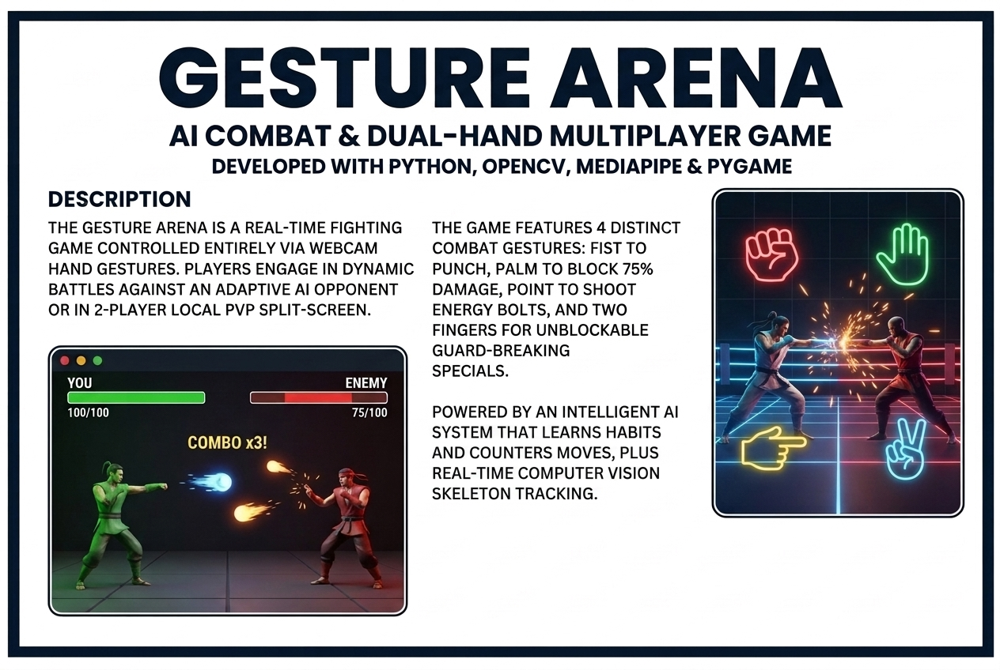

# ⚔️ Gesture Arena

> A real-time AI combat game controlled entirely by your hand gestures using a webcam.


---

## 🎮 Gameplay

Control your fighter using nothing but hand gestures in front of your webcam:

| Gesture | Action | Effect |
|---|---|---|
| ✊ Fist (0 fingers up) | Attack | 12 HP damage |
| ✋ Palm (all fingers up) | Defend | Blocks 75% incoming damage |
| 👉 Point (index only) | Shoot | Fires a projectile (8 HP) |
| ✌️ Two fingers | Special Move | 20 HP + breaks enemy block |

Hold any gesture steady for **0.25 seconds** to trigger it.

---

## 🤖 Smart AI Enemy

The enemy uses a **3-layer AI brain** — not random, genuinely strategic:

1. **Pattern Recognition** — builds a Markov chain of your gesture history and predicts what you'll throw next
2. **Reaction Delay** — simulates real human reaction lag (fast on Hard, slow on Easy)
3. **Strategic Engine** — considers HP levels, your combo streak, and aggression weighting before acting. Displays its reasoning live on screen

---

## 🎯 Difficulty Levels

| | 🟢 Easy | 🟡 Normal | 🔴 Hard |
|---|---|---|---|
| Attack cooldown | 3.0s | 2.0s | 1.2s |
| Reaction time | 0.8s | 0.4s | 0.15s |
| Pattern trust | 30% | 65% | 92% |
| Blunder chance | 35% | 15% | 4% |
| Damage per hit | 6–12 | 10–18 | 14–24 |

---



---

## 🎮 Game Modes

### 1. 🤖 Single Player (vs Adaptive AI)
- Challenge an AI that learns your gesture frequency, counters your combos, and adapts across **Easy**, **Normal**, and **Hard** modes.

### 2. 👥 2-Player Local PvP (Split-Screen on 1 Webcam)
- Battle a friend side-by-side on the same camera!
- **Player 1 (Left hand in camera frame)**: Controls the Green Fighter.
- **Player 2 (Right hand in camera frame)**: Controls the Red Fighter.
- Independent hold timers, real-time projectile dodging, and guard-breaking specials!

---

## 🕹️ Controls

| Key / Action | Function |
|---|---|
| Hold Gesture (0.25s) | Trigger Attack / Defend / Shoot / Special |
| `F11` or `F` | Toggle Fullscreen on / off |
| `1` or `2` | Select Mode on Main Menu |
| `R` | Instant Rematch / Restart |
| `ESC` | Back to Menu / Quit |

---

## 🚀 Installation & Running

```bash
# 1. Clone the repo
git clone https://github.com/rajv82565-code/Gesture-Arena.git
cd Gesture-Arena

# 2. Install dependencies
pip install -r Requirements.txt

# 3. Run the game
python gesture.py
# (or python main.py)
```

> On first run, the MediaPipe hand model (`hand_landmarker.task`) downloads automatically (~8MB).

---

## 🏗️ Tech Stack

| Library | Purpose |
|---|---|
| MediaPipe (Tasks Vision) | Real-time dual hand landmark detection (21 keypoints per hand) |
| OpenCV | Webcam capture, frame flipping, and visual HUD overlays |
| Pygame | Game loop, particle systems, animations, scaled fullscreen |
| NumPy | High-performance matrix & frame operations |

---

## 📄 License

MIT — free to use, modify, and distribute.